<table>
<tr>
<td width="45%" align="center">



</td>
<td width="55%" valign="top">

<div align="center">

[](https://git.io/typing-svg)

```bash
┌──(ace㉿dev-machine)-[~]
└─$ cat about_me.txt
```

</div>

- 💻 &nbsp; Full-stack developer & system architect
- 🎮 &nbsp;Indie game developer — Unity & C#
- 🌐 &nbsp;Web developer — React, Flask, Node.js
- 📊 &nbsp;Technical lead — Marmu Barber & Tattoo Shop booking system *(case study)*
- 🛠️ &nbsp;Focused on workflow automation, reproducible builds, and clean documentation
- 📍 &nbsp;Philippines

</td>
</tr>
</table>


<div align="center">

```bash
└─$ ls -la ./tech_stack/
```


## Languages

<p>


</p>

## Frontend

<p>


</p>

## Backend

<p>


</p>

## Database

<p>


</p>

## Tools

<p>


</p>

</div>

<br>

<div align="center">

```bash
└─$ ./fetch_stats.sh --live
```

</div>

<div align="center">

<!-- 
 -->
# Hidden
</div>


<!-- <div align="center">


</div>

<div align="center">


</div> -->

<br>

<div align="center">

<!-- ```bash
└─$ cat achievements.log
```

 -->

```bash
└─$ cat expertise.log
```

```text
Backend Development      █████████████░   90%

Frontend Development     ████████████░░   85%

System Architecture      █████████████░   90%

Unity Development        ███████████░░░   80%

Database Design          ████████████░░   88%

UI/UX                    ██████████░░░░   75%
```
</div>

<br>

<div align="center">

```bash
└─$ ls -la ./featured_projects/
```

</div>

### 📂 Featured Project

**Marmu Barber & Tattoo Booking System**
Full-stack scheduling and booking platform built with **Flask + MongoDB Atlas**, deployed on **Railway/Render** with cloud integration.

### 🐍 Python Projects
- **Booking & Scheduling Systems** — Flask + MongoDB Atlas backend powering real-world shop operations
- **Automation Scripts** — Workflow tools for cloud backups (Google Drive, OneDrive)
- **Academic Writing Toolkit** — Python scripts to generate natural, human-like prose
- **Data Utilities** — Custom parsers, format converters, reproducible build scripts

### 🎮 Unity Game Projects
- Indie games, e-learning apps, and prototypes built with Unity and C#

### ⚙️ Currently Building
- 🖥️ Multi-sensor visualization dashboard with polished UI
- 🤖 iAssist — AI-integrated chatbot in Python *(mobile version in progress)*
- 🎓 Gamified E-Learning Android game built in Unity 6 *(Capstone project)*

<br>

<div align="center">

```bash
└─$ echo $CONTACT_INFO
```

[](https://github.com/00aceee)
[](mailto:leonardomarkace.pdm@gmail.com)

<br>


<sub>🕒 Terminal session ends here — thanks for stopping by.</sub>

</div>